<!-- saturno -->

  

<!-- apresentação -->
<h2 align="center">Hi! My name is Guilherme and I am a computer science student at UFMA.</h2>

<table align="center" width="100%" border="0">
  <tr>
    <td width="65%" valign="top">
      <h3>About me</h3>
      

        process process process process process process process process process process
      

      

        
        
      

    </td>
    <td width="35%" align="center" valign="middle">
      
    </td>
  </tr>
</table>

<!-- separação -->

  

<!-- linguagens e ferramentas -->
<h3 align="center">Languages & tools I use</h3>

<table align="center" width="100%" border="0">
  <tr>
    <td width="55%" align="center" valign="middle">
      
      
      
      
      
      
      
      
      
      
      
        
      
      
      
      
      
      
      
      
      
    </td>
    <td width="45%" align="center" valign="middle">
      
    </td>
  </tr>
</table>

<!-- 2 melhores repositorios -->
<h3 align="center">Best repositories</h3>

<table align="center" width="100%" border="0">
  <tr>
    <td width="50%" valign="top">
      <h4><a href="https://github.com/Guixrz/studies-gsap.js">📁 REPOSITORIO_1</a></h4>
      
Descrição curta do primeiro repositório: o que ele faz e qual problema resolve.

      
    </td>
    <td width="50%" valign="top">
      <h4><a href="https://github.com/Guixrz/Sistema-Gerenciamento-Extensao/tree/lp2-entrega-3">📁 REPOSITORIO_2</a></h4>
      
Descrição curta do segundo repositório: o que ele faz e qual problema resolve.

      
    </td>
  </tr>
</table>

<!-- tech stack -->
<h3 align="center">Tech stack</h3>

  
  
  
  
  

<!-- arvore sakura -->

  

